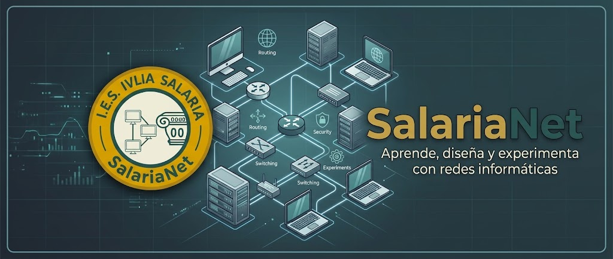

<p align="center">
  
</p>

# SalariaNet — Simulador de Redes para el Aula

[](https://github.com/ajmartostorres-hub/SalariaNET/releases)
[](https://github.com/ajmartostorres-hub/SalariaNET/releases/latest)
[](https://github.com/ajmartostorres-hub/SalariaNET/releases/latest)
[](LICENSE)
[](https://pyside.org)

**SalariaNet** es una aplicación de escritorio para **Windows y Linux** diseñada para aprender redes en el aula:
permite **dibujar esquemas de red, configurar los equipos y ver cómo viajan los paquetes** de un dispositivo a otro,
al estilo de Cisco Packet Tracer, pero **sencillo, ligero, libre y completamente en español**.

Combina una simulación paso a paso de los protocolos reales (Ethernet, ARP, IP, ICMP, DHCP, DNS, TCP y HTTP) con una
**línea de comandos al estilo Cisco IOS** y un **modo real** en el que los equipos del esquema se comunican de verdad
a través de la red del centro, sin necesidad de configuraciones avanzadas ni entornos de programación.


---

## 📥 Descarga e Instalación (.exe y .deb)

No necesitas instalar Python ni configurar dependencias. Puedes ejecutar **SalariaNet** directamente en tu equipo:

1. **Accede a las versiones oficiales:**
   Dirígete a la sección de [**Lanzamientos / Releases**](https://github.com/ajmartostorres-hub/SalariaNET/releases).

2. **Descarga el archivo de tu sistema:**

   | Sistema | Archivo |
   |---|---|
   | Windows 10 y 11 (64 bits) | `SalariaNet_Instalador.exe` |
   | Windows 7 SP1 (32 bits) | `SalariaNet_Instalador_Win7.exe` |
   | Ubuntu 20.04 o posterior (64 bits) | `salarianet_<versión>_amd64.deb` |

3. **Instala y ejecuta la aplicación:**
   * **Windows:** haz doble clic sobre `SalariaNet_Instalador.exe` y sigue los pasos. Puedes instalarlo para todos los
     usuarios (pide administrador y configura el cortafuegos) o solo para ti (sin administrador).
   * **Linux:** abre un terminal en la carpeta de descarga y ejecuta:

     ```bash
     sudo apt install ./salarianet_*_amd64.deb
     ```

     Después ábrelo desde el menú de aplicaciones o con la orden `salarianet`.

Los esquemas guardados (`.red`) se abren con doble clic. El programa **avisa solo cuando hay una versión nueva** en
GitHub y la puede descargar e instalar (Ayuda → Buscar actualizaciones…).

---

## 🛡️ Nota sobre la advertencia de Microsoft Defender SmartScreen

Al ejecutar un archivo `.exe` descargado de GitHub que no cuenta con un certificado digital comercial de pago, es
normal que Windows muestre la advertencia *"Windows protegió su PC"*.

### ¿Cómo omitir esta advertencia?

1. Haz clic en el enlace **"Más información"** (*More info*) en la ventana flotante de SmartScreen.
2. Haz clic en el botón **"Ejecutar de todos modos"** (*Run anyway*).
3. La aplicación se instalará y se abrirá con normalidad.

La primera vez que uses el **modo Real** o la **Conexión aula**, Windows preguntará si SalariaNet puede usar la red:
hay que **permitirlo en redes privadas**. En Linux, si el cortafuegos está activado: `sudo ufw allow SalariaNet`.

---

## ✨ Características Principales

* **Esquemas de red con arrastrar y soltar:** PC, portátil, servidor, impresora, móvil, tablet, Smart TV, hub, switch,
  router y punto de acceso WiFi, unidos por cable o de forma inalámbrica.
* **Simulación paso a paso:** sobres animados por cada paquete, pausa (F5), paso a paso (F6), control de velocidad,
  filtros por protocolo y detalle de las capas de cada paquete. Solo se muestran los sobres entre los equipos que se
  comunican (las difusiones a todos se pueden activar).
* **Tres modos de trabajo:**
  * **Simulado:** todo ocurre dentro del programa, con las IP del esquema.
  * **Real:** un PC del esquema es el ordenador de verdad, con su IP y sus órdenes `ping`, `tracert`, `ipconfig`…
  * **Intranet del aula:** los SalariaNet de varios ordenadores se descubren solos y los paquetes viajan por la red
    del centro.
* **Línea de comandos Cisco IOS:** `enable`, `configure terminal`, `ip address`, `no shutdown`, `ip route`,
  `ip dhcp pool`, `vlan`, `switchport`, `show running-config`, `show ip route`… con abreviaturas y `?`.
* **Configuración sin terminal:** campos rellenables para interfaces, rutas y DHCP del router, mostrando debajo las
  órdenes IOS equivalentes.
* **Servicios de red:** DHCP (automático en el router o con pools), DNS, servidor web y navegador, VLAN 802.1Q y
  spanning tree simplificado.
* **Calcular IPs:** reparte las direcciones de todo el esquema de una vez, con las rutas estáticas entre routers.
* **Límite de equipos por red:** tiene en cuenta la máscara, la dirección de red y la de broadcast, y avisa cuando en
  una red no caben más equipos.
* **Calculadora IP:** red, broadcast, primera y última IP, número de equipos y máscara en binario, con las cuentas.
* **Gestión de proyectos:** guardado y lectura de esquemas en archivos `.red`, impresión y memoria en PDF.

---

## 💻 Requisitos del Sistema

* **Sistema Operativo:** Windows 10, Windows 11 (64-bit), Windows 7 SP1 (versión aparte) o Linux (Ubuntu 20.04 o
  posterior, 64-bit).
* **Conexión de red:** solo necesaria para el modo Real, la intranet del aula (puertos **UDP 41000 a 41050** de la
  red local) y la búsqueda de actualizaciones. El modo Simulado funciona sin conexión.
* **Espacio libre en disco:** ~150 MB.

---

## 🛠️ Tecnologías Internas

* **GUI & Lógica:** Python 3 + PySide6 (Qt6 for Python); PySide2 (Qt5) en la versión de Windows 7.
* **Motor de simulación:** Ethernet, ARP, IPv4, ICMP, UDP (DHCP, DNS) y TCP (HTTP) programados en Python.
* **Red del aula:** descubrimiento y túneles por UDP entre los ordenadores del centro.
* **Instaladores:** PyInstaller + Inno Setup (Windows) y paquete `.deb` (Linux).

📖 Manual de uso completo: [Manual_SalariaNet.pdf](Manual_SalariaNet.pdf) (también en Ayuda → Cómo se usa).

---

## 📜 Licencia y Créditos

* **Autor:** Alfonso José Martos Torres — I.E.S. Ivlia Salaria.
* **Licencia:** Distribuido bajo la licencia **GNU General Public License v3.0 o posterior (GPLv3+)**. Consulta el
  archivo [LICENSE](LICENSE).
* Los instaladores incluyen PySide6 y Qt 6 sin modificar, distribuidos con la licencia LGPL v3.
